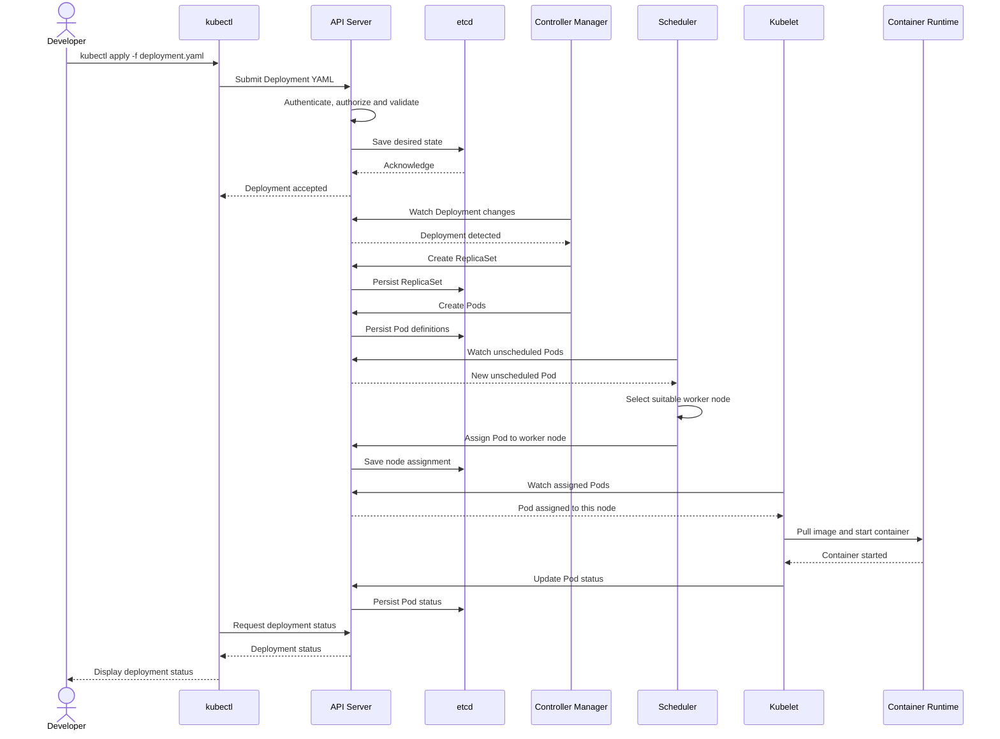

# K8s Architecture

- **Node** is a virtual machine
- **Control plane/master node** is a VM with Administrative components
- **Worker node** is where the actual containers run.
- Contianers are encapsulated inside **pod**. Pod can contain one or more containers. Containers share  the resources of a pod.

-  Client(kubectl) interacts with the cluster using **ApiServer** 
- **Scheduler** decides which pod to be scheduled on which node based on different factors.
- **Controller Manager** is responsible for managing various controllers.

- **ETCD Server** is Key-value database that stores the cluster state and configuration

- **Kubelet** is a Node-level agent that helps container management and receives instructions from Api server.

    The Kubelet does not rely on a direct push or request from the API Server. Instead, it establishes a watch stream to the API Server and continuously monitors for updates to resources it's responsible for. When a pod is scheduled to a node, the Kubelet on that node detects the change via its watch stream, retrieves the pod's spec, and proceeds to pull the necessary container images and run the pod. So, the API Server doesn't directly notify the Kubelet; it's the Kubelet that actively watches for updates.

- **Kube proxy** is responsible for  Pod-to-pod networking and communication

[Refer for diagram](https://github.com/piyushsachdeva/CKA-2024/tree/main/Resources/Day05#kubernetes-architecture)

# Kubernetes Deployment Sequence Diagram

