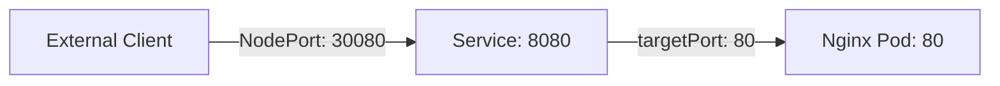

#### NodePort
- Application is exposed on a port i.e.; node port
- Default NodePort range is 30000–32767.
- You can specify a static nodePort, or let Kubernetes allocate one automatically.
- targetPort: Port where the application container listens; is the destination port on the selected Pod.
- port: Port exposed by the Kubernetes Service inside the cluster. It is the Service's port and can be accessed by other Pods and clients inside the cluster.
- nodePort: Port exposed on each node for external access.




```yaml
apiVersion: v1
kind: Service
metadata:
  name: nodeport-nginx-service
  labels:
    env: demo
spec:
  type: NodePort
  selector:
    app: nginx
  ports:
    - port: 80
      targetPort: 80
      nodePort: 30001
```

#### ClusterIP

- Default Kubernetes Service type.
- Used for internal communication within the cluster.
- Provides a stable internal IP and DNS name for accessing Pods.
- Not directly accessible from outside the cluster.

```yaml
apiVersion: v1
kind: Service
metadata:
  name: clusterip-nginx-service
  labels:
    env: demo
spec:
  type: ClusterIP
  selector:
    app: nginx
  ports:
    - port: 80
      targetPort: 80
```

